 

# 𝙑𝙞𝙨𝙬𝙖𝙣𝙖𝙩𝙝 𝘽𝙖𝙡𝙡𝙖

  
  

**AI/ML · Generative AI · Intelligent Applications**

*Turning data, models, and language-model capabilities into practical software.*

---

## 01 — About Me

- 🎓 Engineering student at **JNTU Hyderabad**, focused on AI and Machine Learning.
- 🧠 Interested in **Machine Learning, Generative AI, NLP, LLM applications, and multi-agent systems**.
- 🛠️ I enjoy developing end-to-end solutions—from data preparation and model evaluation to APIs and database integration.
- ⚙️ Exploring **LangChain, RAG, agentic workflows, and MLOps**.
- 🤝 Interested in collaborating on useful AI/ML and software engineering projects.

## 02 — My Open-Source Universe

*An automatically generated view of my public repositories, technologies, and development activity.*

## 03 — Featured Projects

<table>
  <tr>
    <td width="50%" valign="top">
      <h3><a href="https://github.com/Viswanath-Balla/Digital_Doppleganger">Digital Doppelgänger</a></h3>
      
Multi-Agent AI · Privacy Engineering

      A defensive privacy-auditing system designed to investigate how separate data fragments can combine to reveal sensitive information, with evidence-backed findings and remediation suggestions.
        
      <code>Zetaris</code> <code>LLMs</code> <code>Multi-Agent Workflows</code>
    </td>
    <td width="50%" valign="top">
      <h3><a href="https://github.com/Prithvi-Siddharth/OneClick.AI">OneClick.AI</a></h3>
      
No-Code Machine Learning

      A platform concept for simplifying dataset exploration, preprocessing, visualization, and model experimentation through a unified workflow.
        
      <code>FastAPI</code> <code>TiDB</code> <code>AWS S3</code> <code>Scikit-learn</code>
    </td>
  </tr>
  <tr>
    <td width="50%" valign="top">
      <h3><a href="https://github.com/Viswanath-Balla/AutoGrade">AutoGrade</a></h3>
      
AI for Education · Document Understanding

      An exam-processing application using Gemini Vision for exam-content extraction and SBERT semantic similarity for answer comparison.
        
      <code>Gemini API</code> <code>FastAPI</code> <code>TiDB</code> <code>SBERT</code>
    </td>
    <td width="50%" valign="top">
      <h3><a href="https://github.com/Viswanath-Balla/Customer-Churn-Prediction">Customer Churn Prediction</a></h3>
      
Applied ML · Predictive Analytics

      A churn-prediction pipeline with preprocessing, feature engineering, model comparison, and hyperparameter tuning, emphasizing recall and interpretability.
        
      <code>Python</code> <code>Scikit-learn</code> <code>GridSearchCV</code>
    </td>
  </tr>
</table>

  <a href="https://github.com/Viswanath-Balla?tab=repositories">Explore all repositories →</a>

## 04 — Technology Stack

  

  
  
  
  

  
<strong>Technical skills</strong>

   

  | Area | Skills and tools |
  |---|---|
  | Programming | Python, Java, C++ |
  | Machine Learning | Scikit-learn, Pandas, NumPy, feature engineering, model evaluation |
  | Deep Learning | ANN, CNN, RNN; continuing with LSTMs and Transformers |
  | Generative AI | LLM APIs, LangChain, prompt engineering, semantic similarity, agent workflows |
  | Backend | FastAPI, REST APIs, SQLAlchemy |
  | Databases | PostgreSQL, MySQL/TiDB |
  | MLOps and tools | Git, GitHub, Docker, DVC, MLflow, GitHub Actions |

## 05 — GitHub Analytics

<strong>Profile Overview</strong>

<picture>
  <source media="(prefers-color-scheme: dark)" srcset="./assets/overview.dark.svg" />
  
</picture>

<strong>Contribution History</strong>

<picture>
  <source media="(prefers-color-scheme: dark)" srcset="./assets/contributions.dark.svg" />
  
</picture>

<strong>Language Composition</strong>

<picture>
  <source media="(prefers-color-scheme: dark)" srcset="./assets/languages.dark.svg" />
  
</picture>

## 06 — Contribution Activity

<picture>
  <source media="(prefers-color-scheme: dark)" srcset="https://raw.githubusercontent.com/Viswanath-Balla/Viswanath-Balla/output/matrix-rain-v2-dark.svg" />
  <source media="(prefers-color-scheme: light)" srcset="https://raw.githubusercontent.com/Viswanath-Balla/Viswanath-Balla/output/matrix-rain-v2-light.svg" />
  
</picture>

## 07 — What I'm Exploring

- Building reliable applications with **LLMs and agentic workflows**
- Improving model evaluation and experiment reproducibility
- Applying **MLOps** to practical machine-learning pipelines
- Designing useful AI products with dependable APIs and data systems

## 08 — Let's Connect

  <a href="https://github.com/Viswanath-Balla">GitHub</a>
  &nbsp; · &nbsp;
  <a href="https://www.linkedin.com/in/viswanath-balla-574047344/">LinkedIn</a>

  Designed with curiosity. Built one experiment at a time.

