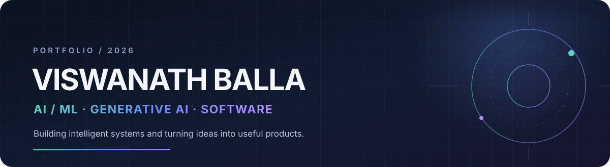

 

&nbsp;

&nbsp;

 

## ✦ A little about me

I'm a Computer Science and Engineering student specializing in **Artificial Intelligence and Machine Learning at JNTU Hyderabad**. I like building things that connect intelligent models with useful, well-engineered software.

My interests span **machine learning, Generative AI, NLP, retrieval-augmented generation, and agentic systems**. I enjoy the full journey: understanding a problem, working with data, evaluating models, and turning the result into an application.

> *Curious by nature. Practical by design. Always building.*

---

## ◈ Selected work

<table>
<tr>
<td width="50%" valign="top">

### <a href="https://github.com/Viswanath-Balla/Digital_Doppleganger">01 / Digital Doppelgänger ↗</a>

A defensive privacy-auditing concept that explores how separate data fragments can combine to expose sensitive information, then surfaces evidence-backed findings and remediation ideas.

**Multi-agent AI** · Privacy Engineering · Zetaris

</td>
<td width="50%" valign="top">

### <a href="https://github.com/Viswanath-Balla/AutoGrade">02 / AutoGrade ↗</a>

An AI-assisted answer evaluation system that extracts exam content and compares student responses using semantic similarity.

**Gemini** · OCR · SBERT · FastAPI

</td>
</tr>
<tr>
<td width="50%" valign="top">

### <a href="https://github.com/Prithvi-Siddharth/OneClick.AI">03 / OneClick.AI ↗</a>

A no-code machine-learning platform concept for dataset exploration, preprocessing, visualization, and model experimentation.

**FastAPI** · Scikit-learn · TiDB

</td>
<td width="50%" valign="top">

### <a href="https://github.com/Viswanath-Balla/Customer-Churn-Prediction">04 / Customer Churn Prediction ↗</a>

An end-to-end churn-prediction workflow covering preprocessing, feature engineering, model comparison, and hyperparameter tuning.

**Python** · Scikit-learn · XGBoost

</td>
</tr>
</table>

[Browse all repositories →](https://github.com/Viswanath-Balla?tab=repositories)

---

## ⌘ Tools I work with

| Focus | Toolkit |
|:--|:--|
| **Machine Learning** | Scikit-learn, Pandas, NumPy, XGBoost, feature engineering, model evaluation |
| **Deep Learning** | TensorFlow, Keras, ANN, CNN, RNN |
| **Generative AI** | LLM APIs, LangChain, RAG, semantic search, agent workflows |
| **Backend & Data** | FastAPI, REST APIs, SQLAlchemy, PostgreSQL, MySQL, TiDB |
| **Engineering** | Git, Docker, DVC, MLflow, GitHub Actions |

---

## ✧ What I'm exploring

- Building reliable applications with **LLMs, RAG, and agentic workflows**
- Improving model evaluation and experiment reproducibility
- Applying **MLOps** practices to practical ML pipelines
- Designing useful AI products with dependable APIs and data systems

### Let's build something meaningful.

[LinkedIn](https://www.linkedin.com/in/viswanath-balla-574047344/) &nbsp; · &nbsp; [GitHub](https://github.com/Viswanath-Balla) &nbsp; · &nbsp; [Repositories](https://github.com/Viswanath-Balla?tab=repositories)

Thanks for stopping by ✦

